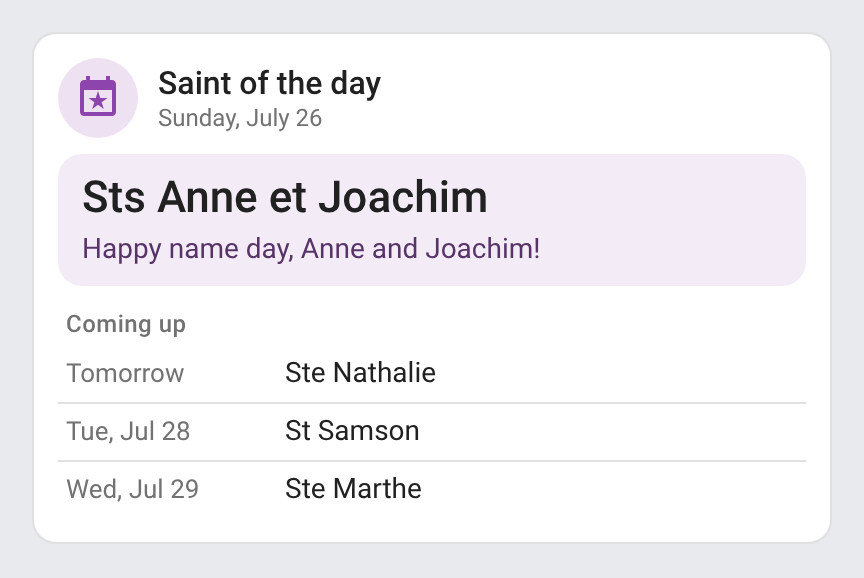
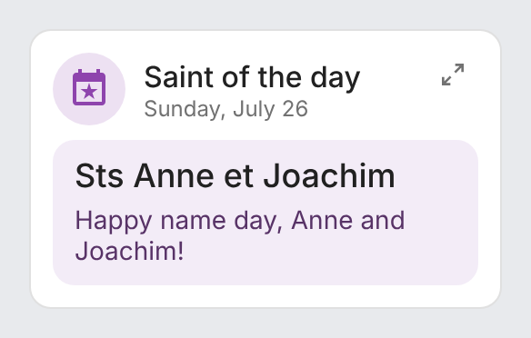
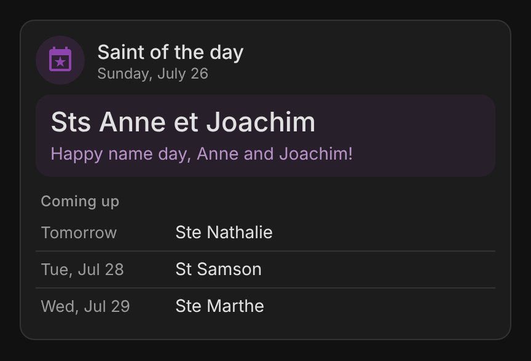
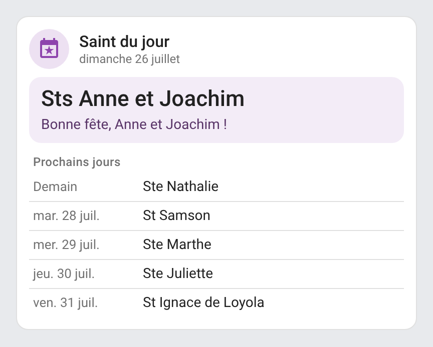
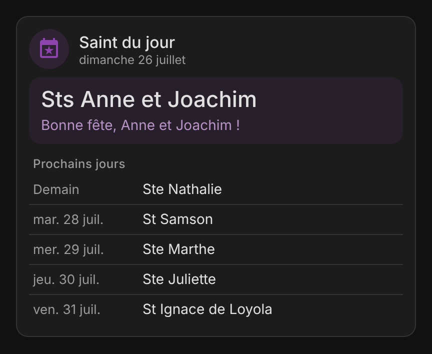
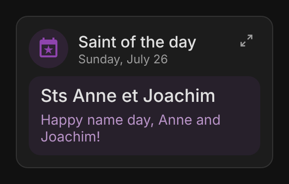

# ha-saint-of-the-day

[](https://www.home-assistant.io/integrations/marketplace/)
[](https://github.com/juju35/ha-saint-of-the-day/actions/workflows/hacs.yml)
[](https://github.com/juju35/ha-saint-of-the-day/actions/workflows/validate.yml)
[](https://github.com/juju35/ha-saint-of-the-day/actions/workflows/lint.yml)
[](https://github.com/juju35/ha-saint-of-the-day/releases/latest)
[](https://github.com/juju35/ha-saint-of-the-day/blob/main/LICENSE)
[](https://buymeacoffee.com/julienstep9)

<p align="center"></p>

Home Assistant integration for the **saint of the day**: the French name day (*fête du jour*) of today and tomorrow, with a Lovelace card included. The calendar is embedded: no account, no external API, nothing to configure.

[](https://my.home-assistant.io/redirect/marketplace_repository/?owner=juju35&repository=ha-saint-of-the-day&category=integration)



## Features

- **Saint of the day** sensor: the calendar label as the state (`Ste Geneviève`, `Sts Anne et Joachim`, `Noël`), with the first names wished, the date and the next 7 days as attributes
- **Saint of tomorrow** sensor, for an evening reminder
- Updated at midnight in the Home Assistant time zone; the 366 days (29 February included) are embedded in the integration
- `custom:saint-of-the-day-card` card, **shipped with the integration** and loaded automatically: today's feast with a name day wish, the date and the next days
- `custom:saint-of-the-day-mini-card` compact card: today's feast, with a button to open the full card
- Visual editor for both cards
- Diagnostics download
- English, French, German, Spanish, Serbian (Cyrillic and Latin), Italian, Dutch, Portuguese, Polish, Romanian, Danish, Swedish, Bulgarian, Russian, Ukrainian, Hungarian, Slovak, Czech, Slovenian, Latvian and Greek (the calendar itself stays French)

## Prerequisites

- Home Assistant 2024.12 or later

## Installation

### Via the Marketplace (recommended)

Click the button below to add the repository directly:

[](https://my.home-assistant.io/redirect/marketplace_repository/?owner=juju35&repository=ha-saint-of-the-day&category=integration)

Then click **Install** and restart Home Assistant.

Or manually:

1. Open **Settings → Marketplace → Add from link** (top right; this needs a GitHub account connected)
2. Add `https://github.com/juju35/ha-saint-of-the-day` — Type: **Integration**
3. Open **Saint of the day** and click **Install**
4. Restart Home Assistant

The card is **part of the integration**: at startup it is added to the dashboard resources (`/saint_of_the_day_static/saint-of-the-day-card.js`, module). After an install or an update, restart Home Assistant and refresh the browser (clear the companion app cache if needed).

If your dashboards are in YAML mode, the card is loaded on every page without going through the resources.

### Manual

Copy `custom_components/saint_of_the_day/` to `/config/custom_components/saint_of_the_day/`, then restart Home Assistant.

## Configuration

### Integration

[](https://my.home-assistant.io/redirect/config_flow_start/?domain=saint_of_the_day)

**Settings → Devices & services → Add integration → Saint of the day**, then confirm. There is nothing to set up, and a single entry is allowed.

| Entity | State | Attributes |
|---|---|---|
| `sensor.saint_of_the_day_saint_of_the_day` | Today's calendar label | `date`, `names`, `upcoming` (the next 7 days: `date`, `label`, `names`) |
| `sensor.saint_of_the_day_saint_of_tomorrow` | Tomorrow's calendar label | `date`, `names` |

The entity ids above are those created with Home Assistant in English; they follow the language of your instance at creation.

### Card

Add the **Saint of the day** card from the card picker: every option is set in the visual editor. In YAML:

```yaml
type: custom:saint-of-the-day-card
```

| Option | Default | Description |
|---|---|---|
| `entity` | detected | The *Saint of the day* sensor |
| `title` | `Saint of the day` | Card title |
| `show_title` | `true` | Show the title in the header (the date stays) |
| `show_wish` | `true` | Show the name day wish under the feast |
| `upcoming_days` | `3` | Next days listed under the feast, from `0` (none) to `7` |
| `language` | Auto | Force language: `en`, `fr`, `de`, `es`, `sr`, `sr-Latn`, `it`, `nl`, `pt`, `pl`, `ro`, `da`, `sv`, `bg`, `ru`, `uk`, `hu`, `sk`, `cs`, `sl`, `lv` or `el` (auto-detects from HA settings) |

Click the feast to open the sensor's details.

### Mini card

A compact card for dashboards: today's feast and the wish. The button at the top right opens the full card in place; a click outside the card folds it back.

```yaml
type: custom:saint-of-the-day-mini-card
```

It takes the same options as `custom:saint-of-the-day-card` (set in the same visual editor); `upcoming_days` applies to the full view.



### Automation example

```yaml
triggers:
  - trigger: time
    at: "08:00:00"
conditions:
  - condition: template
    value_template: "{{ state_attr('sensor.saint_of_the_day_saint_of_the_day', 'names') | count > 0 }}"
actions:
  - action: notify.mobile_app_phone
    data:
      message: >-
        Today is {{ states('sensor.saint_of_the_day_saint_of_the_day') }}:
        happy name day to {{ state_attr('sensor.saint_of_the_day_saint_of_the_day', 'names') | join(', ') }}!
```

### Diagnostics

**Settings → Devices & services → Saint of the day → ⋮ → Download diagnostics** gives the time zone, the day the integration sees and its feast, for bug reports.

## Screenshots

| Light | Dark |
|---|---|
|  |  |

The card in French, with five next days (`upcoming_days: 5`): the date and the wish follow the card's language.

| Light | Dark |
|---|---|
|  |  |

The mini card, compact:

| Light | Dark |
|---|---|
|  |  |

## How it works

The calendar of name days (the classic French calendar, one feast per day) is stored in `data/saints.json`, read once at startup. The sensors compute the day in the Home Assistant time zone and refresh at midnight; nothing is polled and nothing leaves Home Assistant. A day whose feast has no first name to wish (*Noël*, *Toussaint*, *Fête nationale*…) has an empty `names` list: the card then shows the feast without a wish.

## Development

```bash
pip install -r requirements_test.txt && pytest
pip install playwright==1.64.1 && playwright install chromium
python scripts/screenshots.py   # renders the card and mini card stills into screenshots/
```

Python tests live in `tests/` (pytest); the card's JavaScript tests live in `test/` (`node --test test/*.test.mjs`).

### Releasing

1. Bump the version in `custom_components/saint_of_the_day/manifest.json` and `SAINT_CARD_VERSION` in the card
2. Add a `## <version>` section at the top of [CHANGELOG.md](https://github.com/juju35/ha-saint-of-the-day/blob/main/CHANGELOG.md)
3. Push to `main`: the **Release** workflow creates the tag and the GitHub release with the changelog section as notes

## Translations

The integration and the card follow the language of Home Assistant (the card's `language` option can force another one). The calendar labels and first names stay French. Currently supported:

| Language | Code |
|---|---|
| English | `en` |
| Français | `fr` |
| Deutsch | `de` |
| Español | `es` |
| Српски | `sr` |
| Srpski (latinica) | `sr-Latn` |
| Italiano | `it` |
| Nederlands | `nl` |
| Português (Portugal) | `pt` |
| Polski | `pl` |
| Română | `ro` |
| Dansk | `da` |
| Svenska | `sv` |
| Български | `bg` |
| Русский | `ru` |
| Українська | `uk` |
| Magyar | `hu` |
| Slovenčina | `sk` |
| Čeština | `cs` |
| Slovenščina | `sl` |
| Latviešu | `lv` |
| Ελληνικά | `el` |

Brazilian Portuguese (`pt-BR`): pt-BR uses the European Portuguese texts, in the integration and the card.

Contributions for additional languages are welcome!

## License

[MIT](https://github.com/juju35/ha-saint-of-the-day/blob/main/LICENSE)

## Support

If you find this project useful, you can support its development:

<a href="https://buymeacoffee.com/julienstep9"></a>
